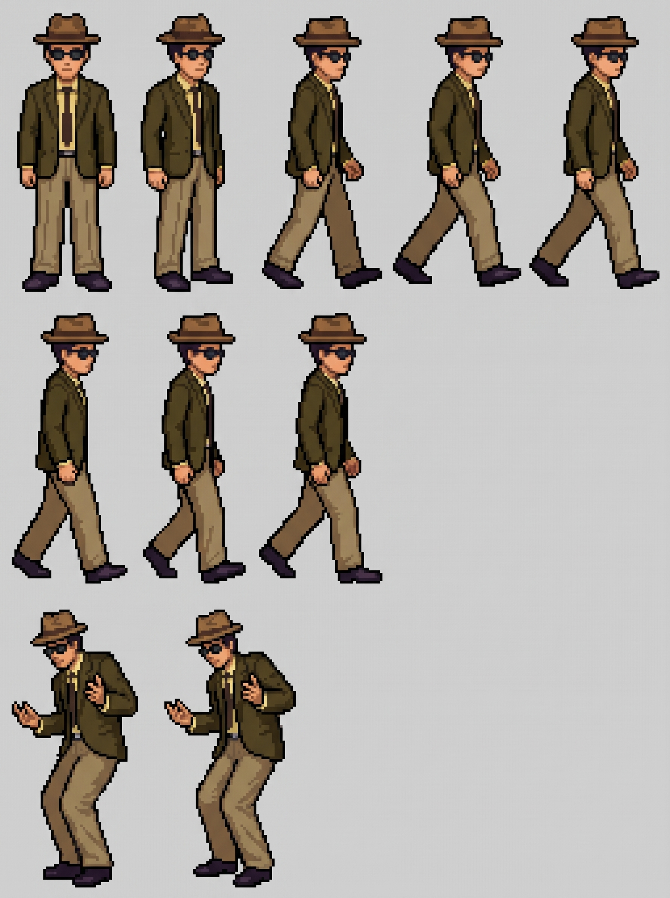

# YOMVI ADVENTURES — Galerías Mall '91

Prototipo jugable de **beat 'em up arcade 2.5D** inspirado en *The Simpsons Arcade* (Konami, 1991), hecho con **HTML5 Canvas + JavaScript vanilla**. Ambientado en el **Galerías Mall de Maracaibo, Venezuela**, en 1991, con un **Stage 2** en el **Hospital General** y un **Stage 3** en la **calle de Galerías Mall y la Burger Room**: tres niveles completos, tres jefes con barras de vida por capas y un final con créditos.

---

## ▶ Cómo jugar

Consulta el [README](../README.md) para instalar, iniciar y probar el juego. El título permite saltar al mall, al hospital o a la calle con **1**, **2** y **3**. La secuencia `AHPUCCA` abre la selección de nivel con las flechas y **Enter** o **Z**.

## 🎵 Música

- **`mall.mp3`** es el tema del Stage 1. Se carga desde `assets/audio/` y **solo empieza a sonar al pulsar START**; permanece en silencio en la pantalla de presentación, en el briefing, en la pantalla de CONTINUE y en el título.
- Cuando el jefe **aparece en escena** (termina su entrada y se muestra su barra), el tema del nivel se detiene y entra **`boss.mp3`** (el mismo tema para los tres jefes).
- **`hospital.mp3`** es el tema del Stage 2: suena en **Recepción, Pasillo y Habitación 302** hasta que aparece Cryptocino; entonces entra **`boss.mp3`**. (Si falta el tema principal, el juego intenta el antiguo `hospital-original.mp3` y luego la melodía hospitalaria procedural).
- **`street.mp3`** es el tema de la calle, el callejón de comida y la Burger Room hasta que aparece GAYTELOS; entonces entra **`boss.mp3`**.
- **`boss.mp3`** es el **tema de jefe compartido**: suena cuando **Arthas**, **Cryptocino** o **GAYTELOS aparecen en escena** (al terminar su entrada y mostrarse la barra de jefe), no al entrar a la zona del jefe. Si falta, cada jefe usa su chiptune de respaldo (`boss` / `boss2` / `burger`).
- Si cualquiera de los MP3 no está en la carpeta, el juego usa automáticamente la banda sonora chiptune procedural (mall / pista de hielo / jefe / hospital / jefe final / calle / burger), también sintetizada con Web Audio.
- Los efectos de sonido (golpes, saltos, monedas, GO!, derrotas, fanfarria) son 100 % procedurales.

## 🎮 Controles

| Acción | Teclas |
|---|---|
| Mover (8 direcciones) | `WASD` / Flechas |
| Atacar (combo de 3) | `Z` / `J` |
| Saltar / patada aérea | `X` / `K` |
| Giro especial (−12 HP) | `C` / `L` |
| Dash | Doble toque ← → / A D |
| Agarrar | `Z` junto a un enemigo aturdido |
| Lanzar (mientras agarra) | `X` / `K` (o dirección opuesta + `Z`) |
| Rodillazo (mientras agarra) | `Z` |
| Pausa | `P` / `Esc` |
| Silenciar | `M` |
| Empezar / continuar | `Enter` / `Z` |
| Stage 2 directo (título) | `2` (debug) |
| Stage 3 directo (título) | `3` (debug) |
| Menú secreto de stages (título) | escribe `AHPUCCA` |
| Móvil · mover | Joystick izquierdo |
| Móvil · golpear / saltar / especial | Botones `GOLPE` / `SALTO` / `ESP.` |
| Móvil · pausa | Botón `II` (o toca la pantalla si está pausado) |
| Móvil · iniciar / continuar | Toca la pantalla |

Consejos de combate:

- El **tercer golpe** es un backhand con maletín: más daño, *hitstop* de 40 ms y derribo.
- La **patada aérea** se activa pulsando ataque en el aire.
- El **giro especial** golpea a todos los enemigos alrededor; cuesta 12 HP.
- Los guardias de seguridad flanquean en vertical y tienen más alcance con la porra.
- Los bouncers son inmunes al agarre y telegrafían una carga brutal.
- **Arthas** tiene tres barras de vida (capas) y dos fases.
- **Cryptocino** (Stage 2) lanza velas de gráfico crypto, embiste, gira con laptop y en fase 2 invoca refuerzos y salta con onda expansiva.
- **GAYTELOS** (Stage 3) lanza hamburguesas, embiste a toda velocidad y aplasta el suelo; en fase 2 gana aura rosa/dorada, invoca refuerzos y salta con giro multigolpe.

## 🕹️ Contenido

- **Intro del creador**: al cargar el juego se reproduce **`intro.mp4`** (logo de AMONGOLICUS PRODUCTIONS). Después hay **2 segundos de pantalla negra** y recién entonces aparece la pantalla de inicio. El título y el input quedan bloqueados hasta que termina el intro.
- **Pantalla inicial**: la portada **`cover.jpg`** muestra un aviso de inicio centrado. En móvil horizontal, el botón **Iniciar** aparece abajo en el centro y el de pantalla completa queda en la esquina inferior izquierda. Durante la partida, el botón de pantalla completa queda junto al de pausa.
- **Guía DEMO de hasta 10 segundos**: al pulsar START y antes del primer nivel aparece una pantalla negra con todos los controles, el aviso de que es un **demo** y el objetivo principal: **Yomvi debe vencer a sus enemigos CLOAQUÍSTICOS** hasta llegar a Arthas. Al terminar, arranca el nivel y la música. También se puede saltar con Start o con un toque.
- **3 zonas en un solo escenario con scroll y bloqueos de cámara**:
  1. **Pasillo central** — azulejos pastel, letreros de neón, palmeras, bancas y papeleras destructibles (sueltan pastelitos, tequeños y refrescos).
  2. **Pista de hielo** — gradas, patinadores animados, iluminación azul y una zona con **fricción reducida**.
  3. **Arcade / Videojuegos** — arco de neón, gabinetes CRT animados, alfombra geométrica y la arena de **Jorge Salinas “Arthas”**.
- **Enemigos**: Mall Punk, Guardia de Seguridad y Bouncer, cada uno con IA y ataques propios.
- **Escenario 2×**: el recorrido total mide **9200 px** (el doble del original). Las tres zonas son más largas, con más tiendas, más pista de hielo, más gabinetes de arcade, **56 props destructibles** y **5 bloqueos de cámara** (4 oleadas + jefe) repartidos para que no haya tramos vacíos.
- **Sistema de nivel de Yomvi**: cada **5 enemigos eliminados** sube un nivel. Cada nivel mejora **+0.2 % ataque, +0.2 % energía y +0.2 % defensa**; los golpes recibidos hacen menos daño y el giro especial consume menos energía. Al subir aparece el mensaje **“SUBISTE DE SAPONIVEL”**, con un indicador **NIV.** y 5 puntos de XP en el HUD.
- **Personajes 20% más grandes**: Yomvi, todos los enemigos, Arthas y Cryptocino se dibujan y golpean a escala ×1.2, con sombras y alcances ajustados.
- **Jefe final en 2 fases**: cargas de patineta, pisotones con onda expansiva, fichas arrojadizas, refuerzos y *body slam* con temblor de pantalla.
- **STAGE 1 CLEAR**: al caer Arthas aparece primero una **pantalla negra de 10 s** con **“ARTHICAS REGRESARA EN AMONGOLICUS ENDGAME”**; después el **tally de 6.5 s** con puntuación, nivel, derribos y tiempo, y arranca automáticamente el Stage 2 conservando puntuación, nivel y vidas.
- **STAGE 2 CLEAR**: al caer Cryptocino aparece primero una **pantalla negra de 10 s** con **“CRYPTOCINO REGRESARA EN AMONGOLICUS ENDGAME”**; después el tally de 6.5 s con puntuación, nivel, derribos y tiempo, y arranca automáticamente el **Stage 3** conservando puntuación, nivel y vidas.
- **Victoria final con teaser**: al caer GAYTELOS, *slow motion*, explosiones y una **pantalla negra de 10 segundos** con el mensaje **“GAYTELOS REGRESARA EN AMONGOLICUS ENDGAME”**; después aparece la fanfarria arcade y la pantalla de **¡JUEGO COMPLETO!** con créditos que celebran los tres stages.

### 🏥 Stage 2 — Hospital General

- **3 zonas** dentro de un recorrido de **8000 px**:
  1. **Recepción / Sala de Espera** — mostrador, sillas, máquinas expendedoras, plantas, carteles de “LAVA TUS MANOS”, reloj y luces fluorescentes. Oleada de **camilleros**, **médicos** y **seguridad hospitalaria**.
  2. **Pasillo Central** — puertas dobles con mirilla, camillas, carrito de ECG con traza animada, letreros de **EMERGENCIA / RADIOLOGÍA / HABITACIONES** y una **zona de evento NPC**.
  3. **Habitación 302** — cama con paciente bajo cobija, suero con goteo, monitor ECG parpadeante, ventana con persianas y la **arena final de Cryptocino**.
- **Evento NPC**: al limpiar la oleada del pasillo aparece una chica más baja que Yomvi (jean negro, franela blanca) al lado derecho. Si te acercas a ~70 px, se pausan los spawns y sale sobre Yomvi un **globo de diálogo pixel-art**: **“Te gusta el pipi o la totona?”**, con blips retro. Dura **3.5 s** o se cierra con **Z / X**; luego parpadea la flecha amarilla **“GO! →”**.
- **Enemigos nuevos**: **Orderly** (rápido, bata teal y mascarilla), **Doctor** (flanquea y golpea con portapapeles) y **Security** (pesado, porra y gorra). Todos con sprites procedurales de 16 bits.
- **Props destructibles**: carritos médicos, papeleras, sillas, sueros y camillas. Sueltan **botiquines (+35)**, **jugos (+15)** o **pastelitos (+28)**.
- **CRYPTOCINO** (`cryptocino.jpg`) — jefe de 3 capas y 480 HP:
  - **Fase 1**: ráfagas de **velas crypto rojas/verdes**, dash a toda velocidad y giro con laptop que lanza proyectiles.
  - **Fase 2 (<50 %)**: aura de brasas rojas/doradas, más velocidad, invoca **1–2 refuerzos** y ejecuta un **salto sísmico** con onda expansiva.
  - Al morir: *slow motion*, explosiones, **teaser de 10 s** con **“CRYPTOCINO REGRESARA EN AMONGOLICUS ENDGAME”** y luego el **STAGE 2 CLEAR → Stage 3**.
- **Continuidad**: al caer Cryptocino se conserva la partida para el Stage 3; la victoria real del juego ocurre al derrotar a GAYTELOS.

### 🍔 Stage 3 — Calle Galerías Mall y Burger Room

- **3 zonas** dentro de un recorrido de **8400 px**:
  1. **Calle afuera de Galerías Mall** — fachada del mall con letrero luminoso, vitrinas, carros estacionados, postes de luz, puestos de comida con vapor y una oleada de **comensales**, **callejeros** y **bouncers callejeros**.
  2. **Callejón de comida** — carritos de hamburguesas y perros calientes, mesas plásticas, carteles de menú, bombillos colgantes y la **zona de evento NPC**.
  3. **Burger Room** — la arena final: sofás, mesas, sillas, alfombras y relojes con forma de hamburguesa, pósteres, mostrador con monitor “GAYTELOS.EXE” y el letrero neón de **BURGER ROOM**.
- **Evento NPC**: al limpiar la oleada del callejón aparece un muchacho de piel morena clara, pelo oscuro corto, lentes, **polo gris** y **jean azul** junto a un carrito, a la derecha de la pantalla. Si te acercas a ~70 px, se pausan los spawns y sale sobre él un **globo de diálogo pixel-art** con el texto exacto **“Esta muy rica la hamburguesa Yomvi, gracias papi”**, con blips retro. Dura **3.5 s** o se cierra con **Z / X**; luego parpadea la flecha amarilla **“GO! →”**.
- **Enemigos nuevos**: **Diner** (comensal con camisa abierta y bandeja), **Tough** (callejero con bandana y cadena) y **Street Bouncer** (grandote con chaleco negro y camiseta amarilla).
- **Props destructibles**: papeleras, neveras/coolers, mesas plásticas y sofás/mesas de hamburguesa. Sueltan **hamburguesas (+40)**, **perros calientes (+30)**, **pastelitos (+28)** y **refrescos (+15)**.
- **GAYTELOS** (`gaytelos.jpg`) — jefe final de 3 capas y 660 HP:
  - **Fase 1**: ráfagas de **hamburguesas con semillas** (rebotan), **dash** a alta velocidad y **golpe de suelo** con onda expansiva que hace saltar los muebles de hamburguesa.
  - **Fase 2 (<50 %)**: aura **rosa y dorada** parpadeante, más velocidad y agresividad, invoca **1–2 refuerzos** y ejecuta un **salto con giro multigolpe**.
  - Al morir: *slow motion*, explosiones, **teaser de 10 s** con **“GAYTELOS REGRESARA EN AMONGOLICUS ENDGAME”** y luego la **victoria total del juego + créditos**.
- **Hoja `gaytelos.jpg`**: el cargador detecta sus **dos filas irregulares** (7 poses neutrales/caminata arriba y 6 poses de zancada/ataque abajo), las recorta por separado, normaliza la orientación y arma un ciclo de caminata de 4 poses, además de las poses de golpe. Si el archivo falta, usa el **GAYTELOS procedural** (sudadera gris, gorra, lentes y jean azul).

### 🧩 Sistemas comunes

- **Movimiento más fluido**:
  - Ciclos de caminata de 8 poses en los enemigos procedurales.
  - Aceleración/fricción suave, inclinación según la velocidad, *bob* de cadera, respiración en reposo, *squash* al girar y al aterrizar.
  - Micro-fundido de anticipación entre fotogramas de las hojas de sprites (`yomvi.jpg` / `arthas.jpg` / `cryptocino.jpg` / `gaytelos.jpg`) para suavizar sus 3–4 poses.
  - Desempolvado de pasos, polvo de aterrizaje, sombras dinámicas y profundidad por `footY`.
- **Sistema de sprites inteligente**:
  - Detecta automáticamente filas/columnas de `yomvi.jpg`, `arthas.jpg`, `cryptocino.jpg` y `gaytelos.jpg` (escaneo de píxeles, con un modo adaptativo para hojas dibujadas a mano con fondo degradado).
  - Recorta los frames, elimina el fondo gris y normaliza la orientación de las poses de acción.
  - Genera retratos para el HUD y respeta la dirección (`facingLeft`).
  - Si la hoja falta, no se puede leer o tiene un solo frame, usa **pixel-art procedural** con animaciones squash, tilt, lunge, flash blanco y patada.
- **Audio 100 % sintetizado** con Web Audio: temas chiptune para mall / pista de hielo / jefe / hospital / jefe final, más SFX arcade.
- **HUD arcade**: 1UP, puntuación, récord persistente, retrato, barra de vida segmentada, vidas, “FREE PLAY / INSERT COIN” y cuenta atrás de continuar de 10 s. Debajo del HUD hay una franja fija con el nombre, la fase y los tres tramos de vida del jefe.
- **60 FPS** con `requestAnimationFrame`, *hitstop*, screen shake, hit-sparks y ordenación por profundidad.

### 📱 Móvil / táctil

- **Detección automática** de pantallas táctiles: los controles solo aparecen en móvil/tablet, sin estorbar en escritorio.
- **Joystick analógico** a la izquierda con movimiento en 8 direcciones y **doble flick** para el dash.
- **Botones GOLPE / SALTO / ESP.** a la derecha, con multi-touch real: puedes moverte y atacar al mismo tiempo.
- **Botón II** de pausa y **toques en pantalla** para iniciar, insertar moneda y volver al título.
- **Aviso de orientación vertical**: si abres el juego en vertical, aparece la pantalla **“GIRA TU TELÉFONO”**.
- **HUD adaptado**: se oculta la franja de teclas de escritorio y el briefing muestra los controles táctiles.
- Si el navegador bloquea el autoplay, el intro arranca silenciado; toca la pantalla para activar el sonido.

## 📁 Estructura

El [mapa del repositorio](../README.md#trabajar-en-el-juego) indica dónde cambiar cada sistema.

## 🖼️ Sprites personalizados

Las hojas se guardan en `assets/images/`. Si cambias el nombre de un archivo, actualiza su ruta en `src/media/assets.js` para Yomvi o en `src/levels/index.js` para un jefe.

- **Hojas de sprites** con una o varias filas/columnas, separadas por fondo uniforme.
- **Imagen de un solo frame**: aplica animación procedural en tiempo real.
- Si `cryptocino.jpg` falta o no se puede leer, Cryptocino usa un sprite procedural (sudadera gris, lentes y jean oscuro) con animaciones de lunge, bob y flash.
- Si `gaytelos.jpg` falta, GAYTELOS usa un sprite procedural equivalente (sudadera gris con capucha, gorra, lentes y jean azul).
- La hoja de GAYTELOS puede venir dibujada a mano con **fondo gris degradado y sombras suaves**: el juego usa un escaneo adaptativo para separar sus dos filas y recortar cada pose sin mezclarlas.

En las hojas de Yomvi y los dos primeros jefes, la primera fila se usa para poses neutrales, la segunda para el ciclo de caminata y la última para acciones. Las poses de acción se normalizan para mirar en la misma dirección que la caminata. Si reemplazas los personajes, mantén el arte mirando hacia la derecha.

## ⚠️ Notas

- Prototipo de homenaje sin fines comerciales. No está afiliado a Konami, Fox ni a Galerías Mall.
- Los nombres y descripciones de los personajes son ficticios.
- El récord se guarda en `localStorage`.

Hecho con cariño para la nostalgia arcade maracucha. 🕹️🇻🇪
